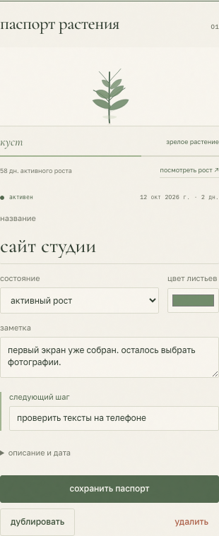
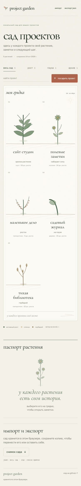
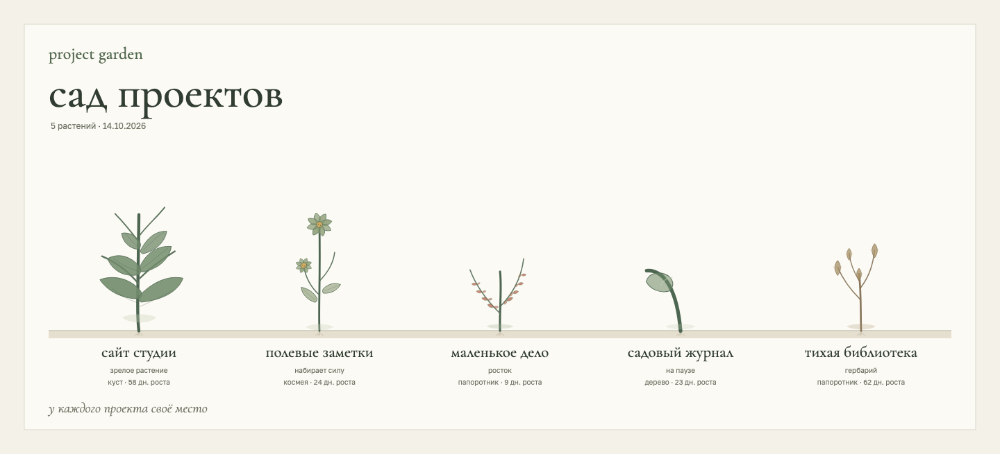
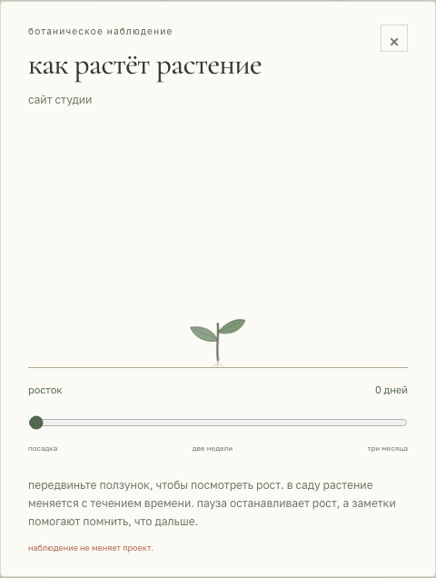

# project garden

локальный сад для проектов, заметок и следующих шагов. у каждого проекта своё растение: оно растёт со временем, отдыхает на паузе и остаётся в гербарии, когда работа завершена.

[открыть сад ↗](https://chebaturkin.github.io/project-garden/)


## как пользоваться

посадите проект, дайте ему название и оставьте следующий шаг. выберите растение на грядке, чтобы открыть паспорт: там можно изменить цвет, состояние, заметку, описание и дату обновления. изменения сохраняются в этом браузере.

- ищите по названию, описанию, заметке, следующему шагу и именам файлов;
- выбирайте растения в росте, на паузе или в архиве, сортируйте по названию, состоянию и обновлению;
- дублируйте и удаляйте проекты;
- сохраняйте весь сад в json для переноса в другой браузер;
- импортируйте zip как список имён файлов, размеров и дат;
- скачивайте png текущей грядки со всеми её рядами. поиск и фильтр учитываются.

растения слегка покачиваются, у каждого свой ритм. ветер можно выключить под грядкой; системная настройка уменьшения движения тоже учитывается. на телефоне растения стоят по два в ряд, а большой сад занимает несколько грядок.

<details>
<summary>паспорт растения, мобильный сад и экспорт</summary>

<table>
  <tr>
    <td valign="top" width="50%"></td>
    <td valign="top" width="50%"></td>
  </tr>
</table>

снимок использует те же рисунки и стадии роста, что и сад:



</details>

## как растут растения

в паспорте есть «посмотреть рост». ползунок показывает, как выбранное растение меняется за три месяца. наблюдение не меняет проект.

| возраст активного роста | растение |
| --- | --- |
| первые дни | маленький росток |
| до двух недель | появляются листья и различия между видами |
| с 14-го по 44-й день | растение набирает силу |
| с 45-го дня | зрелый куст, папоротник, космея или дерево |

пауза и архив останавливают часы. при возвращении к росту возраст продолжает накапливаться. редактирование заметок и даты обновления сохраняет размер растения. вид определяется идентификатором проекта и остаётся прежним; копия начинает новую жизнь с нуля.

<details>
<summary>посмотреть рост в работающем приложении</summary>



</details>

## данные и ограничения

проекты хранятся в indexeddb и резервном зеркале localstorage. приложение обрабатывает импортированные файлы в браузере, не распаковывает zip и не выполняет его содержимое. сервер, аккаунт и ключи api не нужны.

между устройствами автоматической синхронизации нет. очистка данных сайта удаляет сад, поэтому время от времени стоит сохранять json. шрифты загружаются из google fonts; при недоступном соединении браузер использует запасные шрифты.

при первом открытии появляются пять примеров. их можно изменить или удалить. очищенный сад останется пустым после перезагрузки.

| формат | предел |
| --- | --- |
| json | 5 мб и 500 проектов в одном файле |
| zip | 100 мб, 10 000 записей и 500 мб заявленного распакованного размера |
| список файлов | сохраняется до 500 безопасных имён |

пути вроде `../secret.txt`, абсолютные пути и управляющие символы отклоняются. zip64 не поддерживается. если идентификатор импортируемого проекта уже есть в саду, импорт создаст отдельную копию.

## запустить локально

сборка и установка зависимостей не нужны:

```bash
python3 -m http.server 4173
```

откройте [локальный сад](http://localhost:4173). из-за модулей javascript нужен статический сервер; двойной клик по `index.html` не подходит.

## проверки и снимки

```bash
node --test tests/*.test.mjs
node --check app.js
node --check garden-core.js
node --check plants.js
node --check garden-export.js
```

браузерный сценарий проверяет сохранение, паузу и возобновление, черновики, поиск, импорт, оба экспорта, клавиатуру, уменьшение движения и 500 растений на ширине от 320 до 1440 px:

```bash
python3 -m pip install playwright pillow
python3 -m playwright install chromium
python3 scripts/verify-browser.py --url http://localhost:4173
```

с флагом `--capture` тот же сценарий сохраняет скриншоты работающего приложения, экспорт и анимацию для этой страницы в `docs/images/`.

## устройство и публикация

| файл | за что отвечает |
| --- | --- |
| `index.html`, `styles.css` | сцена, паспорт и адаптивный интерфейс |
| `plants.js` | ботанические рисунки и часы роста |
| `garden-core.js` | нормализация, поиск, сортировка и импорт json |
| `app.js` | локальное хранилище, взаимодействия и чтение zip |
| `garden-export.js` | png из тех же растений, что и в саду |

публикация на github pages выполняется из `main` через [workflow](.github/workflows/pages.yml). решения по текущему визуалу описаны в [спецификации](docs/superpowers/specs/2026-10-14-living-garden-design.md).
