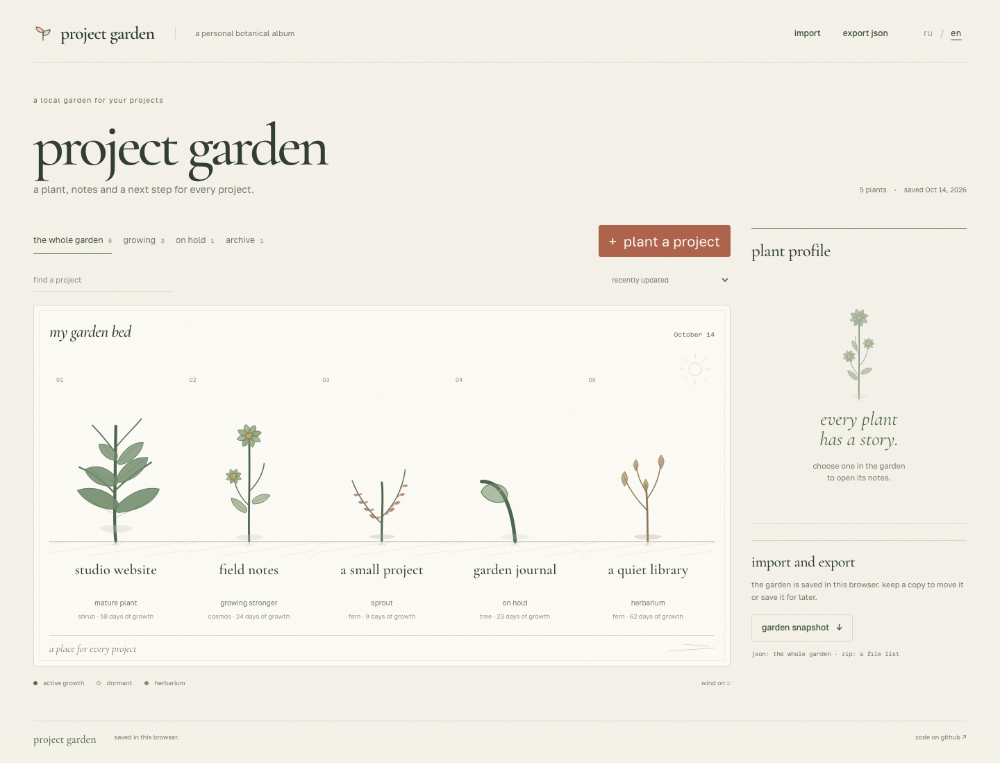
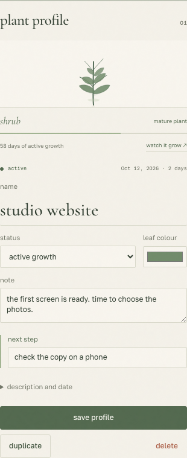
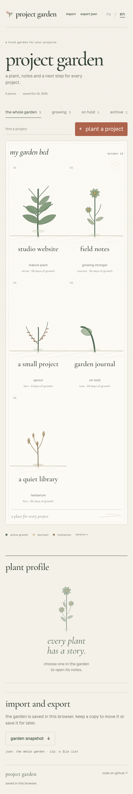
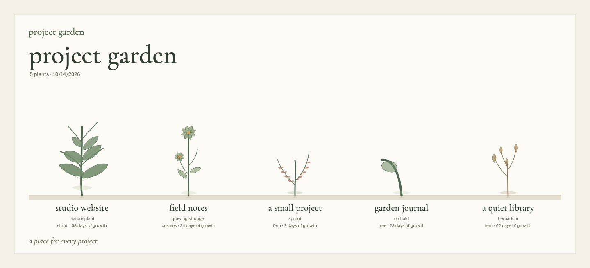
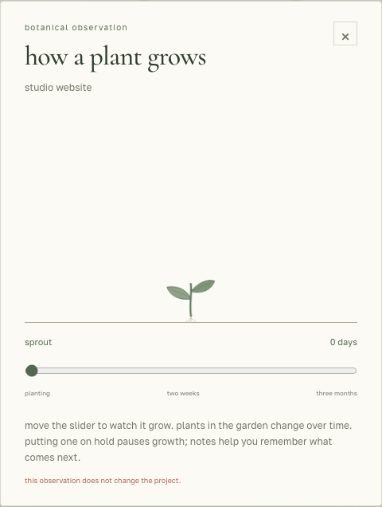

**english** · [русский](README.ru.md)

# project garden

a garden for projects you want to keep close. give each one a plant, a note and a next step. the plant grows over time, rests on hold and stays in the herbarium when the work is done. the garden is saved in this browser.

[open in english ↗](https://chebaturkin.github.io/project-garden/?lang=en) · [open in russian](https://chebaturkin.github.io/project-garden/?lang=ru)



## using the garden

choose “plant a project”, give it a name and leave a next step. selecting a plant opens its profile, where you can change its colour, status, note, description and update date. save the profile to apply those edits.

- search names, descriptions, notes, next steps and file names;
- filter growing, dormant or archived plants and sort by name, status or update date;
- duplicate or remove projects;
- save the whole garden as json to move it to another browser;
- import a zip as a list of file names, sizes and dates;
- download a png of every visible row. search and filters apply to the snapshot.

plants sway at their own pace. turn off the wind below the garden or use your system's reduced motion setting. on a phone, plants sit two per row; larger gardens grow across several rows.

choose **ru / en** in the header to switch language without reloading or losing pending edits. a valid `?lang=ru` or `?lang=en` takes priority, followed by your saved choice, the first supported browser language and english. imported and edited project text stays as you wrote it.

<details>
<summary>plant profile, mobile garden and export</summary>

<table><tr>
<td valign="top" width="50%"></td>
<td valign="top" width="50%"></td>
</tr></table>

the downloaded snapshot uses the same drawings and growth stages as the garden:



</details>

## how plants grow

“watch it grow” in the profile opens a slider for the first three months. the observation does not change the project.

| active growth age | plant |
| --- | --- |
| first few days | a small sprout |
| up to two weeks | leaves and differences between species appear |
| days 14 to 44 | the plant grows stronger |
| from day 45 | a mature shrub, fern, cosmos or tree |

putting a plant on hold or archiving it pauses its clock. resuming growth continues from the same age. editing notes and the update date keeps its size. a project's id determines its species; a duplicate starts growing from zero.

<details>
<summary>watch growth in the running app</summary>



</details>

## data and limits

projects are stored in indexeddb with a localstorage mirror. imported files are processed in the browser. zip contents are neither unpacked nor executed. no server, account or api key is needed.

there is no automatic sync between devices. clearing site data removes the garden, so save json copies from time to time. fonts load from google fonts, with fallback fonts when unavailable.

five examples appear on the first visit. edit or delete them as needed. a garden you empty stays empty after reloading.

| format | limit |
| --- | --- |
| json | 5 mb and 500 projects per file |
| zip | 100 mb, 10,000 entries and 500 mb declared uncompressed size |
| file list | up to 500 safe names |

paths such as `../secret.txt`, absolute paths and control characters are rejected. zip64 is unsupported. an imported project whose id already exists becomes a separate copy.

## run locally

no build or dependency installation is needed:

```bash
python3 -m http.server 4173
```

open the local garden in [english](http://localhost:4173/?lang=en) or [russian](http://localhost:4173/?lang=ru). javascript modules need a static server, so opening `index.html` directly will not work.

## checks and captures

```bash
node --test tests/*.test.mjs
node --check app.js
node --check garden-core.js
node --check plants.js
node --check garden-export.js
```

with the static server still running, install the browser tools and run the interaction, language and export regressions:

```bash
python3 -m pip install playwright pillow
python3 -m playwright install chromium
python3 scripts/verify-browser.py --url http://localhost:4173
APP_URL=http://localhost:4173/ python3 scripts/verify-i18n.py
APP_URL=http://localhost:4173/ python3 scripts/verify-export-snapshot.py
```

the browser regression covers persistence, pause/resume, pending edits, search, import, both exports, keyboard input, reduced motion and 500 plants at 320 to 1440 px. language checks cover defaults, switching with unsaved input, errors, downloads and blocked storage/history. the export regression checks that a png keeps the language and project names present when downloading began, even if the interface changes while images or fonts load.

refresh both sets of screenshots, downloaded snapshots and growth animations from the running app:

```bash
APP_URL=http://localhost:4173/ python3 scripts/capture-bilingual.py
```

the russian images are in `docs/images/`; english images are in `docs/images/en/`. each readme uses its own language, including the example project names.

## source and deployment

| file | purpose |
| --- | --- |
| `index.html`, `styles.css` | scene, profile and responsive layout |
| `plants.js` | botanical drawings and growth clock |
| `garden-core.js` | normalization, search, sorting and json import |
| `app.js` | local storage, interactions and zip reading |
| `garden-export.js` | png from the same plants as the garden |
| `i18n.js` | local dictionaries, locale selection and explicit text bindings |

github pages deploys `main` through the [workflow](.github/workflows/pages.yml), after the node tests and javascript syntax checks pass. the app uses native browser modules and has no build step.
